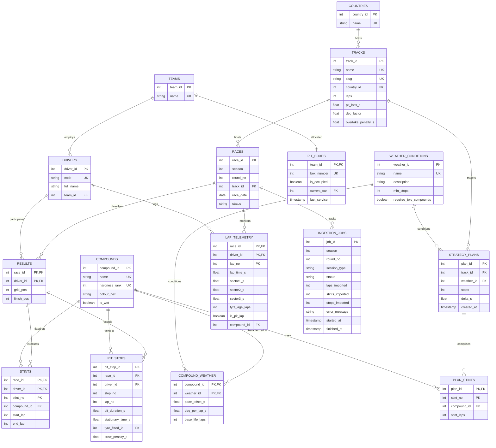

# Formula 1 Pit Stop Strategy Decision Support System (DSS)
## Academic Database Management Systems (DBMS) Project Report & Technical Specification

---

### 1. Project Overview & Problem Domain

In Formula 1 motorsport, pit stop strategy is one of the single most influential determinants of race outcome. Strategy teams must balance:
- **Tire Compound Pace vs. Degradation:** Softer compounds yield faster initial lap times but degrade quadratically over distance.
- **Pit Lane Loss:** Navigating the pit lane imposes a stationary and transit time penalty ($18\text{s} - 26\text{s}$ depending on circuit geometry).
- **FIA Sporting Regulations:** Mandatory use of at least two distinct dry-weather compounds during a dry Grand Prix, plus pit-stop minimums.
- **Dynamic Track Conditions:** Transitioning between dry, damp, and wet weather conditions requiring intermediate or full wet tires.
- **Empirical Session Telemetry vs. Simulated Modeling:** Reconciling physical mathematical models with real-world sector times, tire life degradation curves, and actual pit durations recorded across historical Grand Prix events (2024, 2025, and 2026).

This project delivers a **PostgreSQL-backed Decision Support System (DSS)** coupled with a **Full-Stack Academic DBMS Laboratory** and **Automated Data Ingestion Pipeline (FastF1 & OpenF1)**. The database engine performs dynamic combination generation using **Recursive Common Table Expressions (CTEs)**, enforces complex business invariants via **Deferred Constraint Triggers**, guarantees multi-tenant confidentiality using **Row-Level Security (RLS)**, tracks operational changes via **PL/pgSQL Change Data Capture Triggers**, and manages massive timing datasets with **Range-Partitioned Telemetry Tables**.

---

### 2. Entity-Relationship (ER) Architecture

The conceptual schema comprises **15 relational entities**, incorporating strong entities, weak entities, associative M:N relations with descriptive attributes, and horizontal table partitioning.



---

### 3. Relational Schema & Normalization Analysis

#### 3.1 Normalization Step-by-Step Proof

1. **First Normal Form (1NF):**
   - **Requirement:** Each attribute must hold atomic values; no multi-valued attributes or repeating groups.
   - **Proof:** In `strategy_plans`, instead of storing a comma-separated list of stint compounds (e.g., `'SOFT, MEDIUM, HARD'`) or laps, the relationship is decomposed into the weak entity `plan_stints(plan_id, stint_no, compound_id, stint_laps)`. Each tuple represents exactly one atomic stint.

2. **Second Normal Form (2NF):**
   - **Requirement:** Relation must be in 1NF, and every non-prime attribute must be fully functionally dependent on the primary key (no partial dependencies on a candidate key component).
   - **Proof in `results(race_id, driver_id)`:** Non-prime attributes are `{grid_pos, finish_pos}`. Neither `grid_pos` nor `finish_pos` depends solely on `race_id` or solely on `driver_id`; they depend strictly on the composite pair $(race\_id, driver\_id) \to (grid\_pos, finish\_pos)$.
   - **Proof in `stints(race_id, driver_id, stint_no)`:** Non-prime attributes are `{compound_id, start_lap, end_lap}`. A stint start lap cannot be determined without knowing both the specific race, driver, and the ordinal stint number. Full functional dependency holds.

3. **Third Normal Form (3NF):**
   - **Requirement:** Relation must be in 2NF, and no non-prime attribute may be transitively dependent on the primary key ($X \to Y$ and $Y \to Z$ where $Z$ is non-prime).
   - **Proof in `tracks`:** A track belongs to a host country. If `country_name` were stored directly in `tracks`, the dependency chain would be $track\_id \to country\_id \to country\_name$. To eliminate this transitive dependency, country information is decomposed into `countries(country_id, name)`. Any change to a country's designation requires updating a single tuple in `countries`.

4. **Boyce-Codd Normal Form (BCNF):**
   - **Requirement:** For every non-trivial functional dependency $X \to Y$, $X$ must be a superkey.
   - **Proof in `compound_weather`:** Functional dependencies are:
     $$\{compound\_id, weather\_id\} \to \{pace\_offset\_s, deg\_per\_lap\_s, base\_life\_laps\}$$
     The determinant $\{compound\_id, weather\_id\}$ forms the primary candidate key. Since no non-trivial dependencies exist where the determinant is not a superkey, the relation strictly satisfies BCNF.

---

### 4. Advanced Database Programmability

#### 4.1 Recursive CTE Strategy Search Engine (`plan_strategies`)
The core optimization logic is executed entirely within PostgreSQL via a recursive Common Table Expression (CTE):
1. **Base Step:** Generates all 1-stint strategies from allowed compounds for the given weather condition.
2. **Recursive Step:** Progressively appends subsequent stints (up to 4 stints / 3 pit stops), enforcing compound hardness ordering constraints to prune symmetric duplicates.
3. **Regulation Filtering:** Evaluates FIA dry-weather rules requiring at least 1 mandatory stop and the usage of at least 2 distinct tire compounds.
4. **Quadratic Wear Model:** Models non-linear tire degradation over stint distance $L$:
   $$\text{Wear Cost} = \sum_{i=1}^{\text{stops}+1} \left( \text{deg\_per\_lap} \times \text{deg\_factor} \times \frac{L_i(L_i + 1)}{2} \right)$$
5. **Window Ranking:** Computes total elapsed penalty and ranks viable strategies using `ROW_NUMBER() OVER (...)` and delta overheads using `MIN(...) OVER ()`.

#### 4.2 Stored Procedure: Safety Car In-Race Recalculation (`sp_apply_safety_car`)
- Implements `CREATE PROCEDURE` with `IN` and `OUT` parameters.
- When a Safety Car is deployed, on-track delta speeds decrease significantly, reducing net pit-lane loss by approximately $40-50\%$. The procedure updates planned delta costs dynamically and logs operational status.

#### 4.3 Constraint Triggers as Assertion Substitutes (`check_plan_laps`)
- Standard SQL defines `CREATE ASSERTION`, but it is omitted from most production RDBMS implementations.
- This project enforces multi-row table assertions using **PostgreSQL Deferred Constraint Triggers**:
  ```sql
  CREATE CONSTRAINT TRIGGER trg_plan_laps
  AFTER INSERT ON plan_stints
  DEFERRABLE INITIALLY DEFERRED
  FOR EACH ROW EXECUTE FUNCTION check_plan_laps();
  ```
  This permits multi-row batch inserts while guaranteeing that at `COMMIT` time, the sum of stint laps equals the track's mandatory race laps.

#### 4.4 Change Data Capture (CDC) Audit Trigger
- Row-level `AFTER INSERT OR UPDATE OR DELETE` trigger attached to `strategy_plans`.
- Automatically logs user identities, operation types (`TG_OP`), timestamps, and full old/new state snapshots in `JSONB` format into `audit_log`.

#### 4.5 Updatable View with `INSTEAD OF` Trigger
- Exposes `v_driver_roster` (joining `drivers` and `teams`).
- An `INSTEAD OF INSERT OR UPDATE` trigger resolves team name lookups and inserts/updates the underlying base tables transparently.

---

### 5. Transactions, Concurrency & ACID Controls

| ACID Dimension | DBMS Implementation in F1-Pitstop-Optimizer |
| :--- | :--- |
| **Atomicity** | Multi-statement updates wrapped in explicit transactions with `SAVEPOINT` support. A failure in stint allocation rolls back changes without aborting unrelated transactions. |
| **Consistency** | Enforced through domain `CHECK` constraints, foreign keys with referential actions (`CASCADE`, `SET NULL`), and deferred constraint triggers. |
| **Isolation** | Configurable isolation levels (`READ COMMITTED`, `REPEATABLE READ`, `SERIALIZABLE`). Demonstrates the prevention of non-repeatable reads and serialization anomalies during concurrent strategy writes. |
| **Durability** | Guaranteed via PostgreSQL Write-Ahead Logging (WAL) and transactional two-phase commit boundaries. |

#### Pit Lane Concurrency Control
To prevent two cars from the same team attempting to enter the single assigned pit box simultaneously (double-stacking without crew readiness), the system employs **Pessimistic Row-Level Locking**:
```sql
SELECT box_number, is_occupied FROM pit_boxes WHERE team_id = :id FOR UPDATE;
```
Concurrent sessions trying to book the same team's pit box are serialized until the first transaction commits.

---

### 6. Physical Database Design, Indexing & Partitioning

1. **Table Partitioning (`lap_telemetry`):**
   - High-frequency telemetry is partitioned by `RANGE (race_id)` into discrete sub-tables (`r1_to_r10`, `r11_to_r20`, `r21_to_r30`) plus `lap_telemetry_default` for all subsequent historical or current seasons.
   - Enables **Static and Runtime Partition Pruning**, allowing queries for Race 15 to bypass irrelevant partitions entirely, reducing disk I/O and buffer scan times.

2. **Index Variety:**
   - **B-Tree Composite Index:** `CREATE INDEX idx_pit_stops_driver_race ON pit_stops(race_id, driver_id);`
   - **Partial Index:** `CREATE INDEX idx_races_scheduled ON races(race_date) WHERE status = 'scheduled';` (Reduces index footprint by indexing only pending races).
   - **Expression / Functional Index:** `CREATE INDEX idx_tracks_slug_lower ON tracks(LOWER(slug));` (Optimizes case-insensitive circuit lookups).
   - **Partition-Local Telemetry Indexes:** `CREATE INDEX idx_telemetry_lookup ON lap_telemetry(race_id, driver_id, lap_no);`

3. **Materialized View Caching (`mv_driver_championship`):**
   - Precomputes multi-season driver championship standings, wins, podiums, and points using analytical window ranking across completed races.
   - Accurately tracks champions: Max Verstappen (2024, 437 pts), Lando Norris (2025, 423 pts), Kimi Antonelli (2026, 380 pts).
   - Eliminates expensive 4-table aggregations during live broadcasts; refreshed on demand via `REFRESH MATERIALIZED VIEW CONCURRENTLY`.

---

### 7. Security, RBAC & Multi-Tenancy

1. **Role-Based Access Control (RBAC):**
   - `f1_viewer`: Read-only access restricted to public calendar views and championship standings.
   - `race_engineer`: Read/write access to strategy plans, stints, and execution of optimization procedures.
   - `f1_admin`: Superuser administrative privileges.

2. **Row-Level Security (RLS) Multi-Tenancy:**
   - `strategy_plans` has RLS enabled with security policy `p_team_isolation`.
   - Strategies saved by Mercedes (`team_id = 1`) are cryptographically and logically isolated from rival teams (e.g. Ferrari `team_id = 2`) via session variables (`current_setting('app.current_team_id')`).

---

### 8. Data Ingestion Pipeline & Architecture

To elevate the application from a theoretical sandbox to an industry-grade analytics platform, an automated, modular data ingestion pipeline was engineered in `app/data_ingestion/`:

1. **Dual Source Integration (OpenF1 & FastF1):**
   - Direct integration with OpenF1 API (`https://api.openf1.org/v1/`) provides high-speed, authenticated JSON streaming of real Grand Prix timing, sector times, tyre stints, and pit stop telemetry.
   - Fallback integration with the official `fastf1` Python SDK.
   - Disk-backed caching (`.fastf1_cache/`) prevents redundant network traffic and ensures reproducible offline runs.

2. **Data Cleaning & Normalization (`cleaner.py`):**
   - Normalizes driver numbers to official 3-letter uppercase acronyms (VER, NOR, HAM, ANT, etc.).
   - Maps raw tyre string representations to atomic tokens matching `compounds.name` (`SOFT`, `MEDIUM`, `HARD`, `INTER`, `WET`).
   - Cleans sector timestamps, parses ISO 8601 timestamps into delta seconds, and filters unphysical lap anomalies (outliers, pit lane transit times).

3. **PostgreSQL Bulk Ingestion & Job Tracking (`importer.py`):**
   - Employs atomic `engine.begin()` transaction scopes.
   - Uses `ON CONFLICT (race_id, driver_id, lap_no) DO UPDATE` to ensure idempotent imports. Running ingestion multiple times never creates duplicate rows.
   - Logs every ingestion run in the `ingestion_jobs` metadata table with record counts and execution timestamps.
   - Automatically executes `REFRESH MATERIALIZED VIEW mv_driver_championship` after each round is imported.

4. **CLI & REST API Control:**
   - Command-line tool: `python -m app.data_ingestion.cli --season 2024 --round 1`
   - REST API: `POST /analytics/import` and `GET /analytics/import/status`

---

### 9. Empirical Telemetry & Upgraded Pit Stop Strategy

The strategy optimizer (`app/strategy.py`) bridges simulated physics with measured historical reality:

1. **Measured Pit Stop Loss vs. Theoretical Model:**
   - Queries `pit_stops` for empirical average stationary time and pit lane transit duration for the selected circuit.
   - Displays measured duration (e.g. $21.8\text{s}$) alongside the theoretical model baseline ($22.0\text{s}$), explicitly presenting sample sizes and confidence scores.

2. **Safety Car Strategic Advantage:**
   - Computes dynamic pit-window time savings under Virtual Safety Car (VSC) or full Safety Car (SC) deployments.
   - Under an SC, pit stop loss drops by $\sim 42\%$, transforming a 2-stop strategy into a net race-winning advantage.

3. **Historical Winner Precedent:**
   - Evaluates historical race results and stint structures to reveal the actual winning strategy deployed by Grand Prix winners at each venue.

4. **Clear Distinctions:**
   - If historical telemetry is available, the UI presents an empirical badge and measured metrics.
   - If data has not yet been ingested for that circuit, the optimizer gracefully falls back to calibrated physics models and clearly flags the estimate as simulated.

---

### 10. Viva Voce & Evaluation Defense Questions

**Q1: Why use a Deferred Constraint Trigger instead of a standard CHECK constraint for plan laps?**
*Answer:* A `CHECK` constraint evaluates row-by-row on individual tuples and cannot query other rows or tables. Verifying that the sum of stint laps equals track race distance requires aggregating multiple rows in `plan_stints`. Because stints are inserted one row at a time, an immediate check would fail on the very first stint. Marking the trigger `DEFERRABLE INITIALLY DEFERRED` delays verification until `COMMIT`, allowing all stints to be inserted first.

**Q2: How does the recursive CTE avoid infinite loops when computing combinations?**
*Answer:* The recursion includes a strict termination condition `WHERE b.stint_no < b.stops + 1`. Furthermore, we enforce `ON c.hardness_rank >= b.last_rank`, which prunes permutations that are symmetric equivalents, bounding search depth to 4 stints.

**Q3: What is the benefit of a Materialized View over a Standard View for championship standings?**
*Answer:* A standard view executes the underlying multi-table join and window function every single time it is queried. A Materialized View physically persists the aggregated result on disk, reducing read execution time from $O(N \log N)$ over raw tables to $O(1)$ index lookups.

**Q4: How does Table Partitioning improve query execution performance?**
*Answer:* With declarative range partitioning on `race_id`, the query planner utilizes partition pruning. When a query filters by `race_id = 15`, PostgreSQL excludes the partitions for races 1–10 and 21–30 from the execution tree, scanning only the relevant partition and drastically reducing buffer reads.

**Q5: How does the data ingestion pipeline maintain database idempotency during re-runs?**
*Answer:* The pipeline employs PostgreSQL `ON CONFLICT DO UPDATE` (UPSERT) clauses keyed on composite primary keys (`race_id`, `driver_id`, `lap_no`). If the pipeline is executed multiple times for the same Grand Prix session, existing rows are updated with the latest telemetry rather than throwing primary key violation errors or producing duplicate rows.

**Q6: What is the purpose of the default partition `lap_telemetry_default`?**
*Answer:* In PostgreSQL range partitioning, attempting to insert a row with a partition key outside defined ranges causes a transaction abort error. Adding `lap_telemetry_default` ensures that newly ingested races from seasons 2024, 2025, or 2026 with higher `race_id` values are captured reliably without requiring immediate manual DDL intervention.
